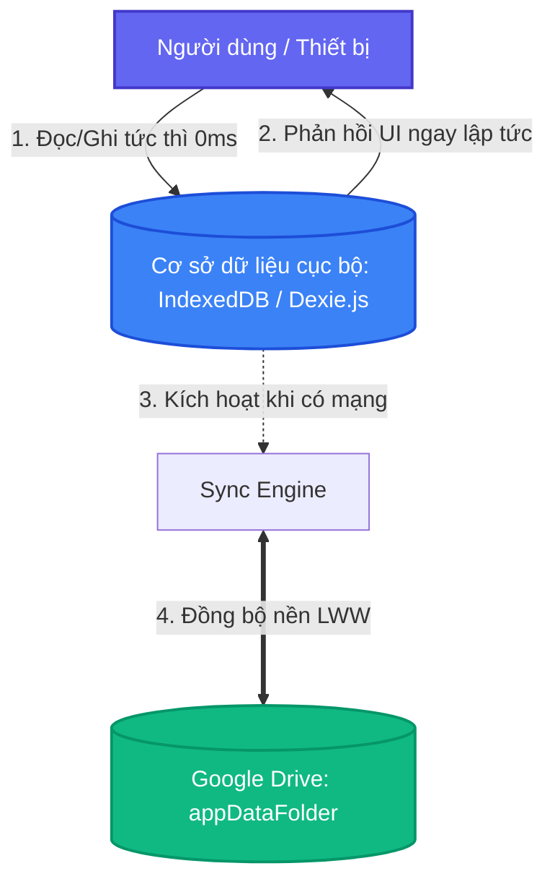
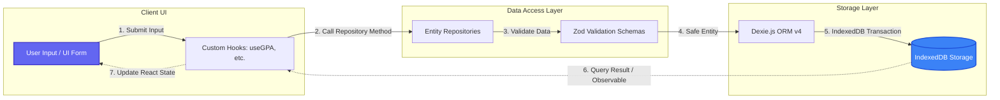
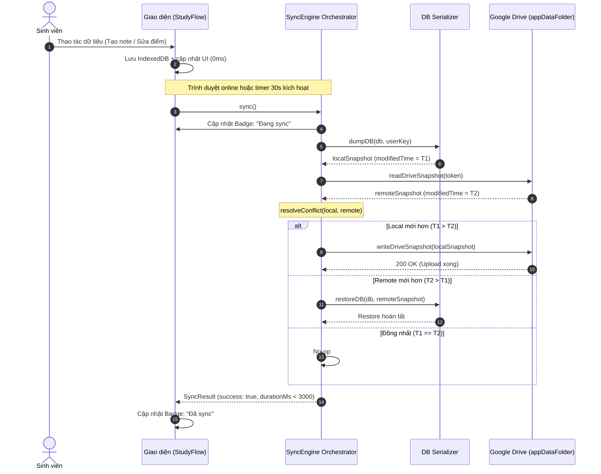
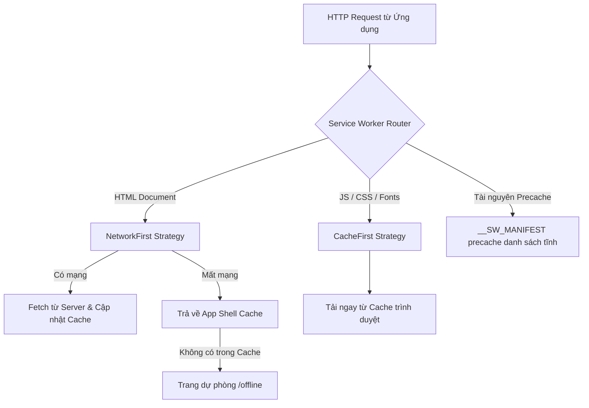

# Kiến trúc Hệ thống — StudyFlow PWA (Local-First Architecture)

> Tài liệu mô tả chi tiết kiến trúc kỹ thuật của hệ thống **StudyFlow — PWA Quản lý Ghi chú & Tiến độ Học tập**, xây dựng theo triết lý **Local-First Software** kết hợp **Progressive Web App (PWA)** và đồng bộ đám mây cá nhân qua **Google Drive Application Data Folder**.

---

## 1. Triết lý Thiết kế: Local-First Software

Hệ thống StudyFlow được thiết kế tuân thủ 7 nguyên tắc cơ bản của phần mềm Local-First (theo nghiên cứu của Martin Kleppmann và cộng sự tại Ink & Switch, 2019):

1. **No spinners / Không độ trễ mạng**: Toàn bộ thao tác CRUD (tạo học kỳ, thêm môn học, ghi chú, tính GPA) được ghi trực tiếp vào cơ sở dữ liệu cục bộ IndexedDB trên thiết bị. Thời gian phản hồi UI là tức thì (< 16ms, 60fps).
2. **Multi-device / Đa thiết bị**: Dữ liệu được đồng bộ hóa xuyên suốt máy tính, tablet và điện thoại thông qua snapshot JSON lưu trên Google Drive cá nhân của người dùng.
3. **Network optional / Mạng là tùy chọn**: Ứng dụng hoạt động 100% đầy đủ chức năng khi ngắt mạng hoàn toàn (offline-by-default).
4. **Seamless collaboration / Đồng bộ liền mạch**: Tự động phát hiện mạng phục hồi (`online` event) và đồng bộ nền (background sync).
5. **The Long Now / Bảo toàn dài hạn**: Dữ liệu thuộc về người dùng, lưu dưới dạng mở (JSON / IndexedDB / Markdown), không bị phụ thuộc vào sự tồn tại của máy chủ trung gian.
6. **Security & Privacy by default / Bảo mật & Riêng tư mặc định**: Không sử dụng máy chủ backend riêng lưu dữ liệu người dùng. Dữ liệu chỉ nằm ở client và Google Drive riêng tư của chính sinh viên.
7. **User retains ultimate ownership / Toàn quyền sở hữu**: Người dùng có thể export, import hoặc xóa dữ liệu bất kỳ lúc nào.



---

## 2. Tổng quan Kiến trúc Hệ thống (System Architecture)

Hệ thống được chia thành 4 tầng kiến trúc phân định rõ ràng (Separation of Concerns):

```
┌─────────────────────────────────────────────────────────────────┐
│                     TẦNG TRÌNH DIỄN (UI / UX)                    │
│   Next.js 16 App Router | React 19 | Tailwind CSS / CSS Modules │
│   - NotesPage (TipTap Rich-text, Tag Filter, Pin/Archive)       │
│   - GPAPage (Bảng điểm, Phân loại học lực, Biểu đồ tín chỉ)     │
│   - ScheduleSlot & Calendar components                          │
│   - AuthButtons & SyncStatus Badge Indicator                    │
└────────────────────────────────┬────────────────────────────────┘
                                 │ React Hooks / State
┌────────────────────────────────▼────────────────────────────────┐
│                   TẦNG DỊCH VỤ & NGHIỆP VỤ (SERVICES)           │
│   - GPA Engine (Thang 10, Thang 4, Điểm chữ, Trọng số 100%)    │
│   - Note Search Engine (Fuse.js offline fuzzy search)           │
│   - TipTap Serializer (TipTap JSON ↔ Markdown roundtrip)        │
│   - Schedule Conflict Detector (Kiểm tra trùng lịch học)        │
│   - Auth State Store (Zustand-like custom store + JWT decode)   │
└──────────────────┬─────────────────────────────┬────────────────┘
                   │                             │
┌──────────────────▼───────────────┐ ┌───────────▼────────────────┐
│   TẦNG DỮ LIỆU CỤC BỘ (LOCAL)     │ │   TẦNG ĐỒNG BỘ ĐÁM MÂY (SYNC)  │
│   - Dexie.js (IndexedDB ORM v4)  │ │   - SyncEngine Orchestrator     │
│   - 7 Entity Repositories        │ │   - DB Serializer (dump/restore)│
│   - Zod Validation Schemas       │ │   - LWW Conflict Resolver       │
│   - Namespace Isolation (Email)  │ │   - Google Drive REST Client    │
└──────────────────┬───────────────┘ └───────────┬────────────────┘
                   │                             │
┌──────────────────▼─────────────────────────────▼────────────────┐
│                     TẦNG NỀN TẢNG PWA & TRÌNH DUYỆT              │
│   - Serwist Service Worker (Precache App Shell, Offline Fallback│
│   - Web App Manifest (Standalone, Maskable Icons, Theme Color)  │
│   - Google Drive API v3 (appDataFolder private storage)         │
└─────────────────────────────────────────────────────────────────┘
```

---

## 3. Tầng Dữ liệu Cục bộ (Local Data Layer)

### 3.1. Thiết kế Schema Cơ sở dữ liệu (Dexie.js / IndexedDB)

Cơ sở dữ liệu client-side sử dụng `Dexie.js` (Wrapper mạnh mẽ trên nền IndexedDB chuẩn W3C).
Hệ thống gồm **7 bảng (tables)** với khóa chính UUID v4 và các chỉ mục (indexes) tối ưu hóa truy vấn:

| Bảng (Table)      | Khóa chính | Chỉ mục (Indexes)                                             | Ý nghĩa nghiệp vụ                                         |
| :---------------- | :--------- | :------------------------------------------------------------ | :-------------------------------------------------------- |
| `users`           | `id`       | `googleId, email, createdAt`                                  | Thông tin tài khoản sinh viên đã xác thực                 |
| `semesters`       | `id`       | `isActive, startDate, endDate, createdAt`                     | Học kỳ (HK1, HK2, Hè), đánh dấu học kỳ hiện tại           |
| `courses`         | `id`       | `semesterId, name, createdAt`                                 | Môn học thuộc học kỳ, số tín chỉ, giảng viên              |
| `gradeComponents` | `id`       | `courseId, createdAt`                                         | Đầu điểm thành phần (chuyên cần, giữa kỳ, đồ án, thi)     |
| `scheduleSlots`   | `id`       | `courseId, dayOfWeek, createdAt`                              | Thời khóa biểu các tiết học trong tuần                    |
| `notes`           | `id`       | `courseId, isPinned, isArchived, *tags, createdAt, updatedAt` | Ghi chú cá nhân, hỗ trợ ghim, lưu trữ và multi-entry tags |
| `tags`            | `id`       | `name, createdAt`                                             | Nhãn phân loại ghi chú theo môn học/chủ đề                |

> **Lưu ý kỹ thuật về Indexing**:
>
> - Trường `*tags` trong bảng `notes` là **multi-entry index** của IndexedDB, cho phép truy vấn trực tiếp tất cả ghi chú chứa một thẻ nhất định bằng `db.notes.where('tags').equals(tagId)` với độ phức tạp $O(\log N)$.
> - Toàn bộ trường `id` được sinh độc lập ở client bằng `crypto.randomUUID()`, loại bỏ 100% xung đột ID khi tạo dữ liệu offline trên nhiều máy.

### 3.2. Đảm bảo Toàn vẹn Dữ liệu bằng Runtime Zod Validation

Mọi dữ liệu đi vào cơ sở dữ liệu đều được xác thực nghiêm ngặt bằng Zod trước khi thực thi lệnh ghi:

- Ràng buộc ngày tháng: `endDate > startDate` trong `SemesterSchema`.
- Ràng buộc điểm số: `0 <= score <= 10`, `weight > 0`, tổng trọng số các thành phần kiểm tra phải đạt 100%.
- Định dạng dữ liệu: Chuẩn ISO Date (`YYYY-MM-DD`), chuẩn 24h (`HH:MM`), mã màu hex (`#RRGGBB`).

### 3.3. Cơ chế Cô lập Dữ liệu theo Người dùng (Namespace Isolation)

Để hỗ trợ nhiều người dùng trên cùng một thiết bị (Shared Devices / Phòng máy thực hành):

- Email của người dùng được chuẩn hóa bằng hàm `deriveUserKey(email)` (chuyển chữ thường, cắt khoảng trắng).
- Tên cơ sở dữ liệu IndexedDB được namespace hóa theo định dạng: `studyflow_db_<normalized_email>`.
- Khi người dùng đăng xuất hoặc chuyển tài khoản, ứng dụng tự động đóng kết nối DB cũ và mở DB tương ứng với tài khoản mới. Dữ liệu giữa các sinh viên được cô lập vật lý ở cấp độ trình duyệt.

### 3.4. Sơ đồ Luồng Dữ liệu Cục bộ (Local Data Flow)



---

## 4. Tầng Đồng bộ Đám mây (Cloud Sync Engine)

Hệ thống áp dụng mô hình **Snapshot-based Synchronization** kết hợp chiến lược giải quyết xung đột **Last-Write-Wins (LWW)**.

### 4.1. Cấu trúc Snapshot (`SyncPayload`)

Thay vì đồng bộ từng bản ghi nhỏ gây phân mảnh và tốn quota HTTP request, toàn bộ trạng thái cơ sở dữ liệu được đóng gói vào một file duy nhất `studyflow-snapshot.json` lưu trong thư mục ẩn bảo mật `appDataFolder` của Google Drive:

```typescript
interface SyncPayload {
  version: number // Version schema (hiện tại = 1)
  modifiedTime: number // Unix ms = max(updatedAt) trên tất cả entities
  userKey: string // Canonical email của chủ sở hữu
  data: {
    users: User[]
    semesters: Semester[]
    courses: Course[]
    gradeComponents: GradeComponent[]
    scheduleSlots: ScheduleSlot[]
    notes: Note[]
    tags: Tag[]
  }
}
```

### 4.2. Ma trận Giải quyết Xung đột (Conflict Resolution Matrix)

Thuật toán `resolveConflict(local, remote)` là một hàm thuần túy (pure function) đưa ra quyết định:

| Trạng thái Local | Trạng thái Remote | modifiedTime so sánh | Bên thắng (`winner`) | Hành động (`Action`)                    |
| :--------------- | :---------------- | :------------------- | :------------------- | :-------------------------------------- |
| Không có dữ liệu | Có dữ liệu        | —                    | `no-local`           | Kéo từ Drive về ghi vào IndexedDB       |
| Có dữ liệu       | Không có dữ liệu  | —                    | `no-remote`          | Đẩy Local lên tạo file trên Drive       |
| Có dữ liệu       | Có dữ liệu        | `local > remote`     | `local`              | Đẩy Local lên ghi đè Remote trên Drive  |
| Có dữ liệu       | Có dữ liệu        | `local < remote`     | `remote`             | Kéo Remote về ghi đè IndexedDB          |
| Có dữ liệu       | Có dữ liệu        | `local === remote`   | `equal`              | Dữ liệu đồng nhất, không cần truyền tải |

### 4.3. Quy trình Đồng bộ Tuần tự (Sync Lifecycle)



### 4.4. Cơ chế Phục hồi Lỗi & Exponential Backoff Retry

Khi gặp sự cố gián đoạn mạng đột ngột (network flap), `SyncEngine` tự động thực hiện thử lại (retry) với thuật toán **Exponential Backoff kết hợp ngẫu nhiên hóa Jitter**:
$$\text{Delay}(attempt) = 500\text{ms} \times 2^{attempt} + \text{jitter}(0 - 200\text{ms})$$

- Số lần thử lại tối đa: `maxRetries = 3` (~500ms, ~1000ms, ~2000ms).
- **Ngoại lệ an ninh**: Khi gặp lỗi xác thực `401 Unauthorized` (Token hết hạn), hệ thống **không retry** mà lập tức thông báo yêu cầu người dùng tái cấp quyền nhằm bảo vệ tài khoản.

### 4.5. Kiến trúc Sao lưu & Khôi phục Cục bộ (Offline Backup / Restore)

Bên cạnh luồng đồng bộ tự động lên Google Drive, StudyFlow cung cấp cơ chế sao lưu ngoại tuyến độc lập (Self-Sovereign Data Portability):

1. **Export JSON**: Trích xuất toàn bộ dữ liệu 7 bảng thành file JSON chuẩn hóa thông qua `dumpDB()`, cho phép người dùng lưu trữ vào USB, ổ cứng hoặc chuyển sang thiết bị khác.
2. **Import JSON & Atomic Transaction**: Khôi phục dữ liệu bằng `restoreDB()` qua transaction nguyên tử (`db.transaction('rw', ...)`). Hệ thống xác thực cấu trúc schema, clear dữ liệu cũ và ghi mới toàn bộ bằng `bulkPut()`. Nếu có bất kỳ lỗi nào, giao dịch sẽ tự động rollback, bảo đảm dữ liệu không bị hỏng hóc một phần.
3. **Google Drive Fault-Tolerance (503 Resilience)**: Khi Google Drive API gặp sự cố (503 Service Unavailable / ngắt kết nối mạng), ứng dụng vẫn tiếp tục đọc/ghi cục bộ bình thường (Local-First), không mất bất kỳ dữ liệu nào. Khi Drive khả dụng trở lại, hệ thống tự động đồng bộ bù mà không gây xung đột.

---

## 5. Tầng PWA & Khả năng Vận hành Ngoại tuyến (PWA & Offline Architecture)

### 5.1. Chiến lược Bộ nhớ đệm Service Worker (Serwist / Workbox)

Hệ thống triển khai Service Worker bằng thư viện `Serwist` được tối ưu hóa riêng cho Next.js 16 Webpack build:



- **App Shell Precache**: Tự động đưa toàn bộ bundle tĩnh HTML, CSS, JavaScript, Web Fonts vào cache khi cài đặt Service Worker (`skipWaiting` và `clientsClaim` ngay lập tức).
- **Fallback Offline**: Cung cấp trang `/offline` với giao diện thông báo trực quan và nút thử lại kết nối khi người dùng truy cập một route chưa từng được cache.
- **Web App Manifest**: Khai báo chuẩn hóa với `display: standalone`, `theme_color: #4f46e5`, bộ biểu tượng tương thích đa nền tảng (192×192, 512×512, maskable icon cho Android, apple-touch-icon cho iOS).

---

## 6. Các Phân hệ Nghiệp vụ Cốt lõi (Core Business Modules)

### 6.1. Phân hệ Tính toán & Dự báo Học tập (GPA Engine)

- Tính điểm trung bình môn học dựa trên công thức trọng số chuẩn:
  $$\text{Grade}_{\text{course}} = \sum_{i=1}^n (\text{score}_i \times \text{weight}_i) \quad \text{với} \quad \sum \text{weight}_i = 100\%$$
- Quy đổi tự động từ Thang điểm 10 sang Thang điểm 4 và Điểm chữ (A+, A, B+, B, C+, C, D+, D, F) theo quy chế đào tạo tín chỉ đại học Việt Nam.
- Tính GPA học kỳ và CPA tích lũy toàn khóa, phân loại học lực (Xuất sắc, Giỏi, Khá, Trung bình, Yếu, Kém).
- Trực quan hóa số tín chỉ tích lũy theo từng học kỳ thông qua biểu đồ diện tích/cột phản ứng nhanh (Chart.js canvas).

### 6.2. Phân hệ Soạn thảo & Tìm kiếm Ghi chú Ngoại tuyến (Notes & Offline Search)

- **Trình soạn thảo TipTap Rich-Text**: Hỗ trợ định dạng văn bản phong phú, tiêu đề (Heading), danh sách đầu dòng (Bullet List), danh sách công việc (Task List với checkbox tương tác), khối mã (Code Block) và trích dẫn.
- **Tuần tự hóa hai chiều (Two-way Serialization)**: Bộ chuyển đổi thuần túy `noteSerializer.ts` chuyển đổi mượt mà giữa cấu trúc TipTap JSON và Markdown chuẩn, phục vụ export và lưu trữ.
- **Tìm kiếm mờ ngoại tuyến (Offline Fuzzy Search với Fuse.js)**:
  - Đánh chỉ mục trực tiếp trong bộ nhớ RAM từ IndexedDB, không gửi bất kỳ truy vấn nào lên server.
  - Phân bổ trọng số tìm kiếm đa trường: Tiêu đề ($\times 2.0$), Thẻ gắn kèm ($\times 1.5$), Nội dung văn bản thô ($\times 1.0$).
  - Ngưỡng mờ (threshold = 0.4) cho phép tìm kiếm chính xác ngay cả khi gõ sai lỗi chính tả nhỏ hoặc thiếu dấu tiếng Việt.

### 6.3. Phân hệ Quản lý Thời khóa biểu (Schedule Manager)

- Quản lý tiết học trong tuần (Thứ 2 đến Chủ nhật) kèm phòng học và thời gian bắt đầu/kết thúc.
- Thuật toán `hasScheduleOverlap()` kiểm tra phát hiện tức thì tình trạng trùng lịch học của sinh viên trước khi lưu vào cơ sở dữ liệu:
  $$\text{Overlap} \iff (\text{Start}_A < \text{End}_B) \land (\text{Start}_B < \text{End}_A) \land (\text{Day}_A = \text{Day}_B)$$

### 6.4. Kiến trúc Trạng thái Giao diện & Tiếp cận (UX States & Accessibility Architecture)

- **Mô hình Trạng thái Toàn diện (State Completeness)**: Mọi màn hình chính đều triển khai đầy đủ 3 trạng thái:
  - _Trạng thái rỗng (Empty State)_: Hướng dẫn người dùng thao tác khi chưa có dữ liệu hoặc tìm kiếm không khớp.
  - _Trạng thái đang tải (Loading / Skeleton)_: Cung cấp phản hồi thị giác trong quá trình truy vấn Dexie DB cục bộ.
  - _Trạng thái lỗi (Error Alert)_: Thông báo lỗi an toàn với thuộc tính trợ thính `role="alert"`, không gây crash ứng dụng.
- **Tiêu chuẩn Khả năng Tiếp cận WCAG 2.1 AA**:
  - Tỷ lệ tương phản màu sắc $\ge 4.5:1$ cho tất cả các nút tương tác và văn bản.
  - Điều hướng hoàn toàn bằng bàn phím qua chuỗi tab order hợp lý.
  - Tích hợp công cụ kiểm định tự động `@axe-core/playwright` bảo đảm 0 lỗi nghiêm trọng.

---

## 7. Mô hình Bảo mật & Quyền Riêng tư (Security & Privacy Model)

1. **Zero-Knowledge Backend**: Ứng dụng không sở hữu server lưu trữ CSDL trung gian. Không ai (kể cả quản trị viên hệ thống) có thể xem hay khai thác dữ liệu học tập và ghi chú của người dùng.
2. **Google OAuth 2.0 & Token Scopes (Least Privilege)**:
   - Sử dụng cơ chế xác thực Google Identity Services.
   - Chỉ yêu cầu scope hẹp: `https://www.googleapis.com/auth/drive.appdata`. Scope này **chỉ cho phép ứng dụng đọc/ghi các file do chính nó tạo ra** trong thư mục ẩn `appDataFolder`, hoàn toàn không thể xem hay truy cập bất kỳ tài liệu cá nhân nào khác trong Google Drive của sinh viên.
3. **Mô hình Lưu trữ Token An toàn (In-Memory / SessionStorage)**:
   - `accessToken` nhạy cảm được ưu tiên quản lý trong bộ nhớ phiên `sessionStorage` và tự động dọn sạch khỏi `localStorage` để giảm thiểu bề mặt tấn công đánh cắp token qua XSS.
   - Thao tác `signOut()` xóa sạch toàn bộ credentials trong mọi kho lưu trữ trình duyệt.
4. **Bảo vệ Chống Tấn công XSS & Content-Security-Policy (CSP)**:
   - Trình soạn thảo TipTap chỉ render các thẻ HTML an toàn đã được định nghĩa trong schema (Paragraph, Heading, TaskItem,...), tự động lọc bỏ các thẻ độc hại (`<script>`, `<iframe>`, `onerror`).
   - Cấu hình tiêu đề bảo mật CSP trong `next.config.ts`: giới hạn nguồn script, style, connect tới các domain an toàn của Google APIs.
5. **Mã hóa trong truyền tải (In-transit Encryption)**: Toàn bộ giao tiếp với Google Drive API bắt buộc thực hiện qua HTTPS (TLS 1.3).
6. **Cô lập cục bộ (Sandbox Isolation)**: Áp dụng Same-Origin Policy và IndexedDB Origin Sandboxing của trình duyệt, đảm bảo các website khác không thể truy cập trái phép dữ liệu của StudyFlow.

---

## 8. Kết luận Kiến trúc

Kiến trúc Local-First kết hợp PWA của StudyFlow giải quyết triệt để bài toán phụ thuộc đường truyền mạng của sinh viên, mang lại trải nghiệm ứng dụng mượt mà như native app trên cả Desktop, Android và iOS, đồng thời trao quyền làm chủ dữ liệu và bảo mật tuyệt đối cho người học.
